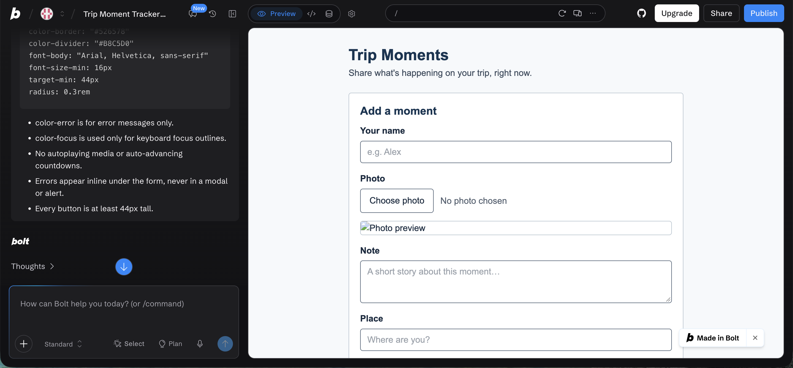
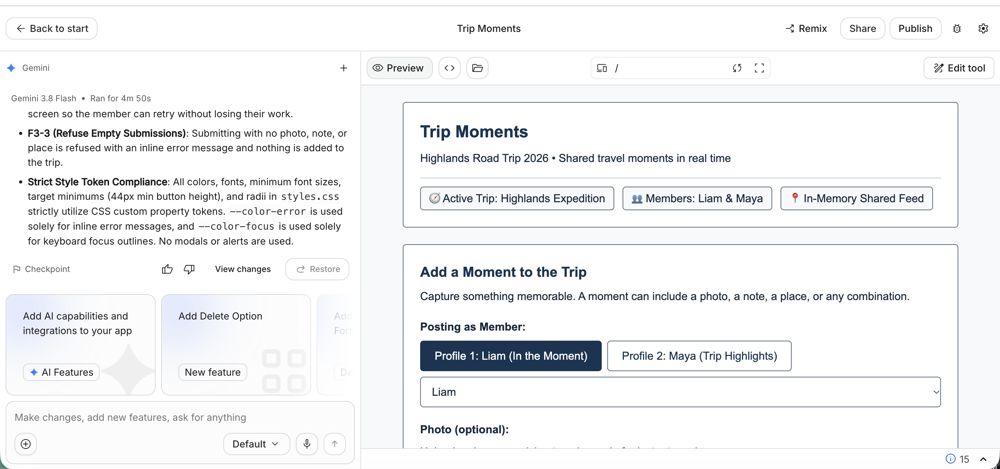

# HW6: Two Builders, One Specification

## Feature

**Team repository:** https://github.com/mehtaaashi05/mgt3745-team-Alpha-
**Spec provenance:** copied from commit `5731bf0d1855f2e91fd7387c55fdc8e5633af116` on 2026-10-15. The team's Phase 2 STYLE.md and SKILLS.md are not merged yet, so `context/STYLE.md` and `context/SKILLS.md` are my HW5 versions.

**Feature:** F3, Add a moment to a trip (Must-be)

F3-1. WHEN a member submits a moment with at least one of a photo, note, or place, the app shall add it to the trip, labeled with the member's name. (probe)

F3-2. IF a review fails to save, THEN the app shall tell the member and keep the photo, note, and location on screen so they can try again.

F3-3. IF a member submits a moment with no photo, note, or place, THEN the app shall refuse and add nothing. (probe)

## See It Work

| bolt.new | AI Studio |
|---|---|
|  |  |

## Status

bolt.new satisfied 2 of 3 F3 rows (F3-2's failure path can never run); AI Studio satisfied 3 of 3 but added 7 unneeded files and invented content. Recommendation: use bolt.new for F3 in Phase 2 and write the save-failure path ourselves against the Worker (weighted 52 to 40, [COMPARISON.md](COMPARISON.md#decision)).

## How to Run the Evals

```bash
npm test
```

The test runs each builder's own `canAddMoment` function (copied from its zip into `evals/impl/`) through the same cases: F3-3 refuses a moment with no photo, note, or place; F3-1 accepts any one of them; and a spec-gap probe checks that a note of only spaces counts as no note. Expected output: 6 tests, 6 pass.

## Links

- [EVALS.md](EVALS.md): Prediction Stake and error log
- [COMPARISON.md](COMPARISON.md): evidence, spec gaps, and recommendation
- [JUDGMENT.md](JUDGMENT.md): judgment eval and agreement rate
- [prompts/PROMPT.md](prompts/PROMPT.md): the exact input both builders received
- [builds/](builds/): bolt.zip and aistudio.zip
- [docs/DDR-001.md](docs/DDR-001.md) (bolt.new), [docs/DDR-002.md](docs/DDR-002.md) (AI Studio)
- Team pull request or issue: https://github.com/mehtaaashi05/mgt3745-team-Alpha-/pull/77
- Deployed Worker: not used; F3 has no AI behavior, so the proxy step does not apply.

## Hours

About 5.5 hours in total: about 40 minutes for the bolt.new build and 1 hour for AI Studio (both including evaluation), with the rest on the Prediction Stake, the judgment eval, the comparison, and review of every file.

## AI Use

- bolt.new (Claude Sonnet) wrote `builds/bolt.zip`: [DDR-001](docs/DDR-001.md).
- Google AI Studio (Gemini 3.8 Flash) wrote `builds/aistudio.zip`: [DDR-002](docs/DDR-002.md).
- Claude (Claude Code) copied the team context, drafted `prompts/PROMPT.md`, the shared eval, the Prediction Stake wording (Gian chose and committed it), the COMPARISON.md evidence, weights, scores, and decision (Gian approved the weights before scoring), both DDR drafts, the error log, JUDGMENT.md questions, and this README. Gian reviewed every file. Claude was not a judgment grader.
- ChatGPT (OpenAI) was the second judgment grader; its prompt and answers are in [JUDGMENT.md](JUDGMENT.md).
